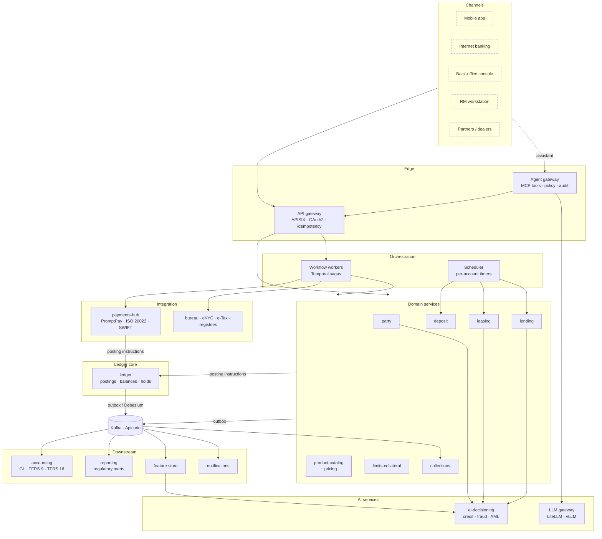
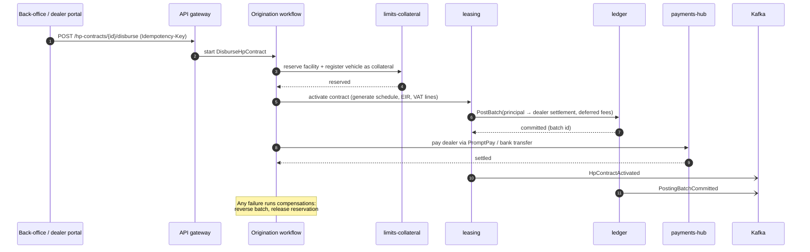
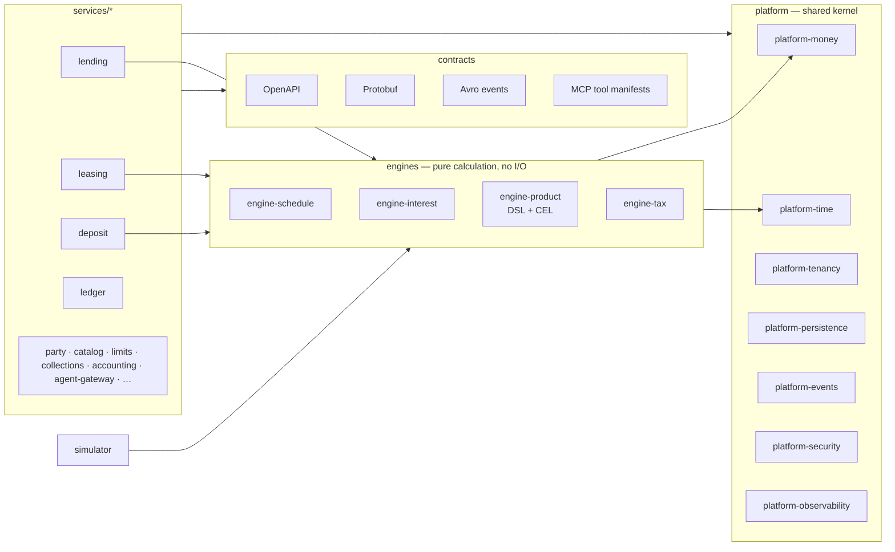
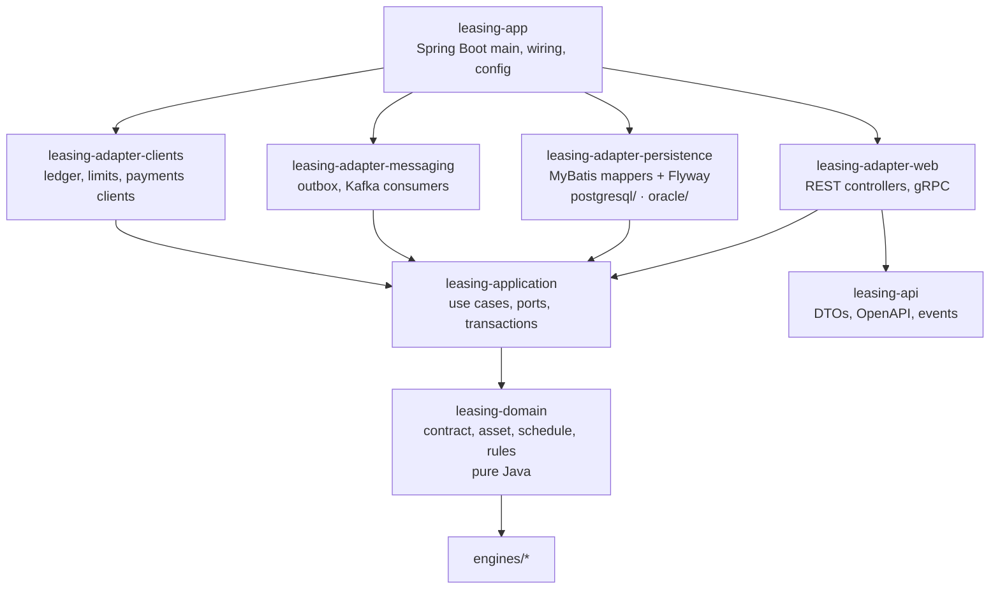

# 10 — Application architecture and modules

This document turns the service map in [02](02-architecture.md) into the structure the code will have: layers, services, the modules inside each service, and the dependency rules that keep them apart. The interactive version, with the prototype screens, is in [`prototype/index.html`](../prototype/index.html).

## 1. Application architecture



### Layer responsibilities

| Layer | Responsibility | Rule |
|---|---|---|
| Channels | Reference UIs and partner apps | Hold no business logic; call public APIs only |
| Edge | AuthN/Z, rate limits, idempotency keys, API versioning; the agent gateway exposes the same APIs as MCP tools | Agents go through the API gateway like any other client |
| Orchestration | Multi-step business processes (onboarding, origination, disbursement, restructuring, repossession) and per-account timers | Coordinates services; owns no business data |
| Domain services | Contract state and business rules per domain | Own their database schema; never write another service's tables |
| Ledger core | The only place value moves | Accepts balanced posting instructions only; knows nothing about products |
| AI services | Models and LLM access | Read features and events; act only through the edge |
| Downstream | GL, reporting, features, notifications | Consume events; never call back into the posting path synchronously |
| Integration | Payment rails and external providers | Adapters translate external formats into domain commands |

### Communication rules

| From → To | Mechanism | Why |
|---|---|---|
| Channel → service | REST/JSON via API gateway | Public contract, OpenAPI |
| Service → service (query) | gRPC, read-only | Low latency; no distributed writes |
| Service → ledger | gRPC `PostBatch` with idempotency key | Single synchronous call on the money path |
| Multi-service write | Temporal saga with compensations | No two-phase commit across services |
| State change → others | Transactional outbox → Kafka | Exactly-once effect via idempotent consumers |
| Agent → anything | MCP tool → agent gateway → API gateway | Same entitlements, limits and audit as a human |

## 2. Request flow: auto hire-purchase disbursement



## 3. Module diagram

The repository is one **Maven multi-module** build (Maven is the default build tool in most bank toolchains; Apache-2.0).



`ledger` is the one service with no arrow to `engines`: it moves value and knows nothing about products.

### Modules inside one service (hexagonal)

Every service has the same shape. Example: `services/leasing`.



| Module | Contains | May depend on |
|---|---|---|
| `*-domain` | Entities, value objects, state machines, domain events, business rules | `platform-money`, `platform-time`, `engines/*` |
| `*-application` | Use cases, inbound and outbound ports (interfaces), transaction boundaries | `*-domain`, `platform-*` interfaces |
| `*-api` | Public DTOs, OpenAPI/Protobuf, event schemas | `contracts` only |
| `*-adapter-web` | REST/gRPC endpoints | `*-application`, `*-api` |
| `*-adapter-persistence` | MyBatis mappers, per-vendor SQL, Flyway migrations | `*-application`, `platform-persistence` |
| `*-adapter-messaging` | Outbox writer, Kafka consumers | `*-application`, `platform-events` |
| `*-adapter-clients` | Clients for other services, generated from their `*-api` | `*-application`, other services' `*-api` |
| `*-app` | Spring Boot entry point and configuration | All of the above |

### Dependency rules (enforced by ArchUnit and the Maven Enforcer plugin)

1. `*-domain` has no Spring, MyBatis, Kafka or JDBC imports. It is plain Java and unit-testable in milliseconds.
2. Dependencies point inward: adapters → application → domain. Never the reverse.
3. A service depends on another service **only through its `*-api` module**. No shared tables, no shared domain classes.
4. `engines/*` are pure functions: same inputs, same outputs, no clock, no I/O. This is what makes simulation, replay and back-valuation deterministic.
5. `ledger` depends on nothing product-specific. It never imports `engines/*` or any product service.
6. `platform-money` forbids `float`/`double` and exposes only `long` minor units and `BigDecimal` with explicit rounding.
7. Database-vendor code lives only in `*-adapter-persistence` under `postgresql/` and `oracle/` folders.

### Repository tree

```
fabor-os/
  pom.xml                              # parent: versions, plugins, enforcer, licence gate
  platform/
    platform-money/  platform-time/  platform-tenancy/  platform-persistence/
    platform-events/ platform-security/ platform-observability/ platform-test/
  engines/
    engine-schedule/ engine-interest/ engine-product/ engine-tax/
  contracts/
    openapi/ proto/ avro/ mcp/
  services/
    ledger/            ledger-domain, ledger-application, ledger-store-postgresql, ledger-store-oracle, ledger-app, ...
    party/  product-catalog/  deposit/  lending/  leasing/  limits-collateral/
    collections/  accounting/  payments-hub/  agent-gateway/  ai-decisioning/
    workflow-workers/  scheduler/
  simulator/
  products/                            # product definitions + golden tests
  prototype/                           # HTML prototype of the back-office console
  infra/                               # OpenTofu, Helm, Argo CD
  docs/
```
